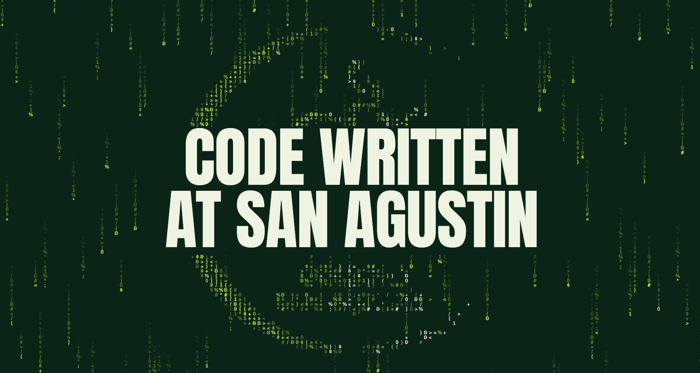
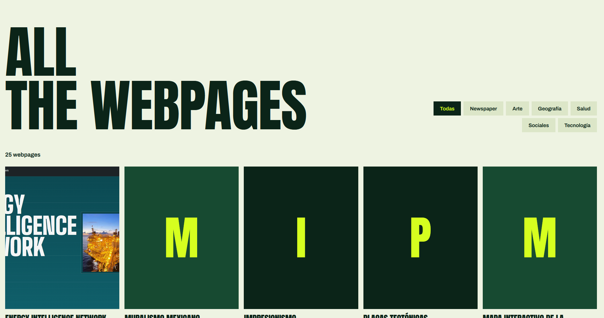

# Webpages proyect
In 2026, the last year proyect for third year secondary school proyects is to create their own website, using html, css and a bit of javascript. This webpage is a gallery to showcase the webpages they have made.
# Screenshots

# Structure
In the main folder, there is this readme file, and the html, css and javascript to make this website possible.
The thumbnail of each web is stored on the thumbnail folder. And each proyect is stored by name in the proyects folder.
# To add a new proyect to the landing page
Go to the script.js file in the main folder. Inside there's a list with the structure it must have: [theme, title, description, authors, link, thumbnail]. Then download your website files(js, html and css) and put them in your website folder. Make sure that the path to the index file inside the script.js file directs to your html. 
Once the website is uploaded, you can set a thumbnail. To do so take a screenshot of you website (Make sure it's of 4:3 aspect ratio), save it and uploaded into the thumbnails folder. Then update the path to the thumbnail inside the script.js file.
# Credits
This website gallery was designed by Mariano Villares. All the websites displayed inside the gallery have their authors' name. 